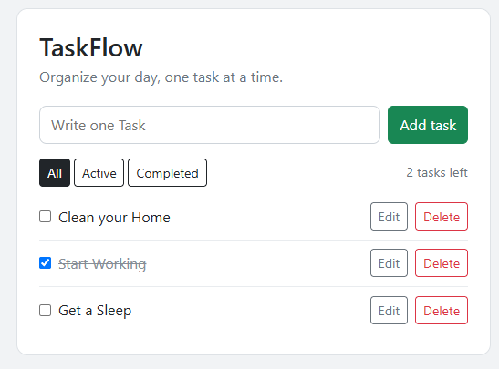

# TaskFlow – To-Do App

A simple task manager built with React, TypeScript and Bootstrap.

Live demo: https://taskflow-todo-app-opal.vercel.app/

## Features
- Add, edit, complete and delete tasks
- Filter by All, Active and Completed
- Shows how many tasks are left
- Saves tasks in the browser, so they stay after a refresh
- Responsive layout that works on phones

## Run locally
npm install
npm run dev